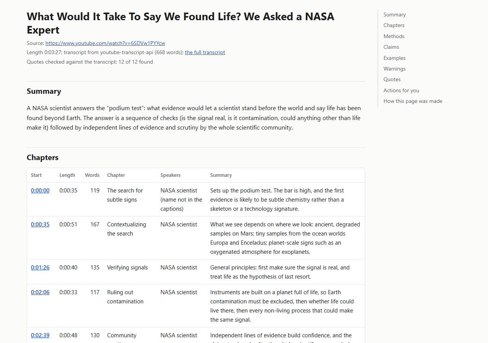
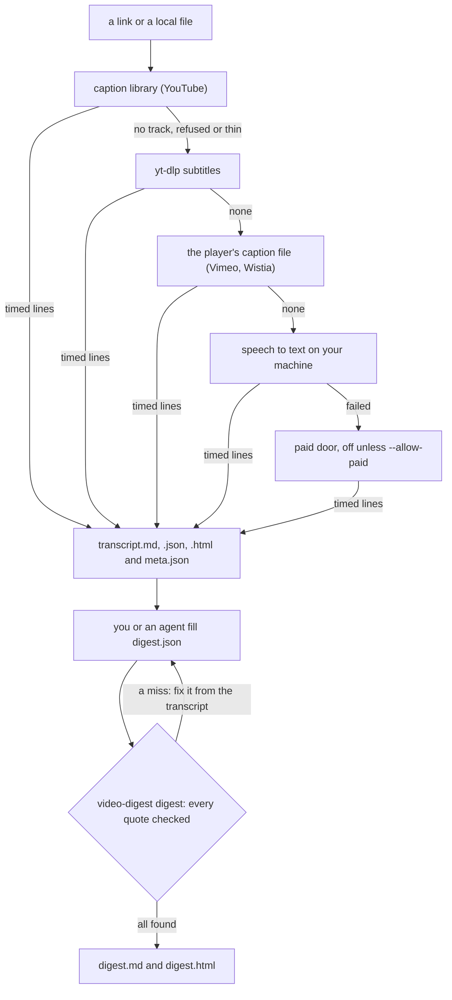
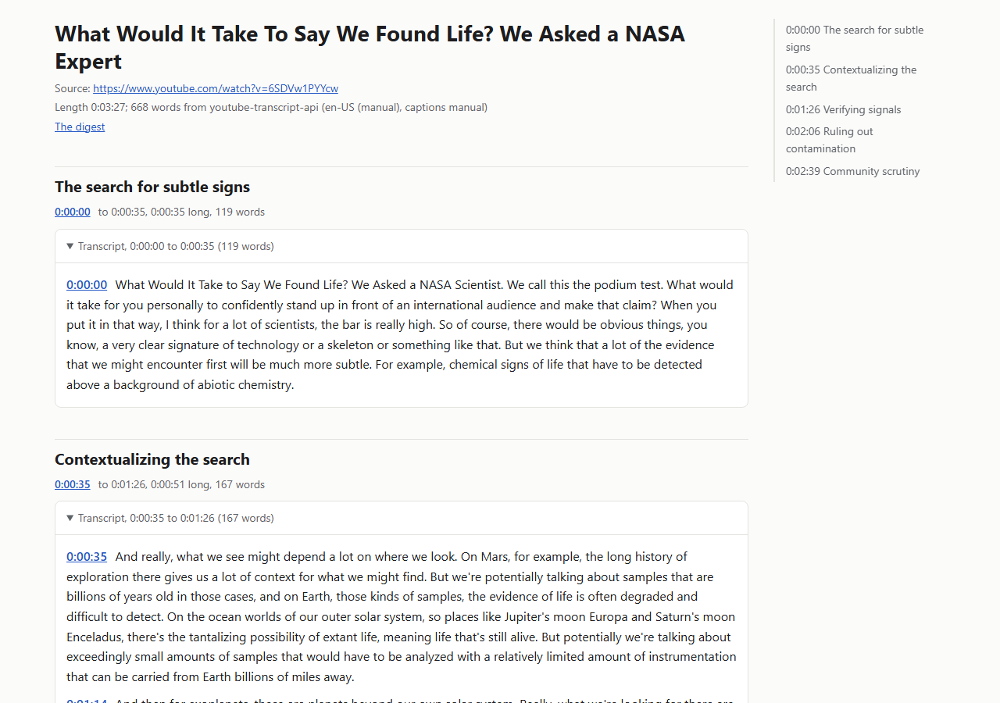

# video-digest

Turn a video into a timed transcript, then into a chaptered digest whose every quote has been checked
against the transcript by script. Free caption doors first, speech to text on your own machine when
there are none, and no language model inside the tool: you (or an agent such as Claude Code) write the
digest, and the tool proves each quote is really in the video at the time you say.

- **Sources:** YouTube, Vimeo, Wistia, any of the [sites yt-dlp supports](https://github.com/yt-dlp/yt-dlp/blob/master/supportedsites.md), and local audio or video files.
- **Free doors first:** the site's own captions before anything else, speech to text on your machine
  when there are none, and a paid service only if you switch it on with your own key.
- **Output per video:** `transcript.md` (timed lines under their chapters), `transcript.json`,
  `transcript.html` (the whole text by chapter, for a person to read), `chapters.json`, `meta.json`
  (every door tried, why it failed, how long it took), and scene stills by chapter when you ask for
  them or the video looks like a screen demo.
- **The digest:** chapters with times, lengths and speakers, every method or claim with its time and
  exact quote, optional extra sections, an optional "actions for you" section, and a note on how the
  page was made, as Markdown and a self-contained HTML page. You (or an agent, through the bundled
  Claude Code skill) write it; the tool checks it.

```
video-digest https://www.youtube.com/watch?v=6SDVw1PYYcw
digests/youtube-6SDVw1PYYcw: 668 words from youtube-transcript-api (en-US (manual)), 5 chapters, 0 stills, 7.41 s
```



See [`examples/youtube-nasa-podium-test/`](examples/youtube-nasa-podium-test/) for a full run: the
transcript files, the filled `digest.json`, the quote check and all three pages.

## What's new in 0.2.0

- **A transcript page for people.** Every run writes `transcript.html`: the whole text under its
  chapters, cut into paragraphs of 30 to 45 seconds (a paragraph ends at the first sentence end after
  30 seconds, or at 45), each paragraph's time a link into the video, each chapter a fold, long
  chapters split into several folds. `video-digest page <folder>` writes it again on its own.
- **More of the digest is checked.** Quotes in the "actions for you" section and in new optional
  `sections[]` (any extra section you want, such as "what we could borrow") are checked against the
  transcript like the main points, and `--snap` moves them too. A placeholder time such as `1:00:1x`
  is refused anywhere in the digest, your own summaries and titles included.
- **Quote links no longer open late on automatic captions.** Automatic caption lines overlap the next
  line on screen; the word clock now spreads each line's words over the time until the next line
  starts, so a quote's time is the second it was said.
- **The digest page says how it was made:** each chapter's length and word count, the doors tried,
  the quote count, the longest stretch with no words on the track, and the versions that made it.
- **A near-empty caption track no longer ends the run.** A track with almost no words for the video's
  length (a music-only track, a placeholder) is kept in reserve while the next doors try; the answer
  with the most spoken words wins, and a thin answer that is kept says so in `meta.json`.
- **Install the skill as a Claude Code plugin** in two commands (below).

The full list is in [CHANGELOG.md](CHANGELOG.md).

## Quick start

From a clean clone, with no network after the install: check the committed example's quotes, then
write its three pages into a copy of it.

```
git clone https://github.com/RobBrautigam/video-digest
cd video-digest
python -m venv .venv
# macOS or Linux: source .venv/bin/activate    Windows: .venv\Scripts\activate
pip install .
video-digest --version

video-digest digest examples/youtube-nasa-podium-test --check-only
# quotes: 12 of 12 found within 75 s

python -c "import shutil; shutil.copytree('examples/youtube-nasa-podium-test', 'digests/try-it')"
video-digest digest digests/try-it
# wrote digests/try-it/digest.md, digests/try-it/digest.html and digests/try-it/transcript.html
```

Open `digests/try-it/digest.html` in a browser. Then a real video (this one needs the network):

```
video-digest "https://www.youtube.com/watch?v=6SDVw1PYYcw"
video-digest digest digests/youtube-6SDVw1PYYcw --init
```

`--init` writes `digest.json` for you to fill and `reading.md` to read from; the full method is in
[the digest step](#the-digest-step).

## Install

```
pip install "video-digest[speech] @ git+https://github.com/RobBrautigam/video-digest"
```

or from a clone: `pip install ".[speech]"`. Python 3.10 or newer.

- **ffmpeg** on your PATH (decoding audio for speech to text, and scene stills). It is an external
  program, not bundled.
- **yt-dlp** comes with the package (`yt-dlp[default]`, which includes the `yt-dlp-ejs` challenge
  solver). For YouTube media downloads (speech to text and stills only; captions do not need it),
  yt-dlp also needs a JavaScript runtime on your PATH: [deno](https://deno.com) or Node.js.
  video-digest enables every runtime it finds.
- **The speech model downloads on first use** from Hugging Face and is cached. The defaults are
  faster-whisper's `base.en` when the speech is known to be English and `base` (multilingual)
  otherwise, about 140 MB each on disk. Larger models (`small`, `medium`, `large-v3`) are more
  accurate and much bigger; pick one with `VIDEO_DIGEST_WHISPER_MODEL`.
- `[speech]` is optional: without it, everything works except the speech door.

### Missing tools?

Captions and the digest step need neither tool. Speech to text and stills need ffmpeg; YouTube media
downloads also need a JavaScript runtime.

| Tool | macOS | Debian or Ubuntu | Windows |
|---|---|---|---|
| ffmpeg | `brew install ffmpeg` | `sudo apt install ffmpeg` | `winget install Gyan.FFmpeg` |
| deno (or Node.js) | `brew install deno` | `curl -fsSL https://deno.land/install.sh \| sh` | `winget install DenoLand.Deno` |

Open a new terminal after installing so the PATH change is seen.

| Environment variable | What it does |
|---|---|
| `VIDEO_DIGEST_WHISPER_MODEL` | Model name (`base.en`, `small`, ...) or a local model folder |
| `VIDEO_DIGEST_MODEL_DIR` | Where speech models are downloaded and cached |
| `VIDEO_DIGEST_WHISPER_DEVICE` | `cpu` (default) or `cuda` |
| `SUPADATA_API_KEY` | Your own key for the optional paid door (also needs `--allow-paid`) |
| `VIDEO_DIGEST_SUPADATA_MODE` | `native` (default, existing captions only), `auto` or `generate` |

## The doors, in order, and why



Each door either returns timed lines or says why not, and the run moves to the next. A refusal (HTTP
429 or a bot check) is never retried in the same run, and requests to one site are spaced by
`--pace` seconds (default 2).

| Source | Door order |
|---|---|
| YouTube | caption library, yt-dlp subtitles, speech to text, paid (off by default) |
| Vimeo, Wistia | yt-dlp subtitles, the player's own caption file, speech to text, paid |
| Any other yt-dlp site | yt-dlp subtitles, speech to text, paid |
| Local file | a caption file beside it (`talk.vtt`, `talk.en.srt`), speech to text |

1. **Caption library** ([youtube-transcript-api](https://github.com/jdepoix/youtube-transcript-api)):
   YouTube hands over a whole caption track, with times, in one answer, so it takes about a second
   whatever the length. Manual captions first, then the automatic track, and never a machine
   translation into another language.
2. **yt-dlp subtitles:** the same rule (manual, then the automatic track in the spoken language,
   which yt-dlp marks `-orig` on YouTube), plus the creator's chapter list, title and length. When
   the caption library wins, video-digest still makes one metadata read for the chapters.
3. **The player's own caption file:** Wistia's captions endpoint and Vimeo's text tracks, read the
   way the embedded player reads them. This door exists because yt-dlp's Vimeo support now asks for
   a login for many videos, while the player's caption file stays public. A player's list does not
   say which track is spoken (its "default" can be a translation), so with no `--lang` it prefers a
   "captions" track, then the known spoken language, then English, and records the guess.
4. **Speech to text** ([faster-whisper](https://github.com/SYSTRAN/faster-whisper)) on the
   original-language audio. The smallest audio track a site offers can be an automatic dub in
   another language; video-digest ranks audio by the site's language preference and an "original"
   note before size, so it reads the voice that was recorded.
5. **Paid** ([Supadata](https://supadata.ai)), last and off by default: it runs only with
   `--allow-paid` and your own `SUPADATA_API_KEY`, and asks for existing captions only unless you set
   `VIDEO_DIGEST_SUPADATA_MODE`.

**A thin caption track keeps the run going.** On a video of a minute or more, a caption answer with
fewer than 5 spoken words a minute (sound tags such as `[Music]` and `(applause)` do not count) is
kept in reserve and the next door runs. The answer with the most spoken words wins; a thin answer that
is kept carries `transcript_notes.thin_transcript` in `meta.json`, and the attempt shows `"kind":
"Thin"`.

`--doors` restricts or reorders them (`--doors speech` forces speech to text), and `--lang` asks for
a language instead of the spoken one.

## Examples

```
# YouTube (a Creative Commons video from NASA)
video-digest "https://www.youtube.com/watch?v=6SDVw1PYYcw"

# Vimeo
video-digest "https://vimeo.com/76979871" --lang en

# Wistia (a page URL, an embed URL, or wistia:<id>)
video-digest "https://fast.wistia.net/embed/iframe/j99ficzros"

# A local file, read by the speech model
video-digest ./clips/belloc-beasts.mp4 --lang en

# Scene stills by chapter, and keep the downloaded media
video-digest "https://www.youtube.com/watch?v=6SDVw1PYYcw" --stills --keep-media
```

`-o` sets the parent folder (default `./digests`); each video gets its own folder named after the
source and its id.

### The proof: four public sources, run end to end

Run with version 0.1.0 on 2026-10-05 from a home connection on a Windows desktop processor, no
cookies, no signed-in browser, no paid call (0.2.0 changed no door; it added the thin-track rule
above). "Door time" is the winning door alone; "wall" is the whole run, metadata and writing included.

| Source | Length | Door used | Words | Timed lines | Chapters | Door time | Wall |
|---|---|---|---|---|---|---|---|
| YouTube, NASA, [CC BY](https://www.youtube.com/watch?v=6SDVw1PYYcw) | 3:27 | caption library (manual en-US) | 668 | 139 | 5 | 1.1 s | 7.4 s |
| Vimeo, [the Vimeo player video](https://vimeo.com/76979871) | 1:02 | the player's caption file (en, chosen from de, es, en, fr) | 124 | 14 | 0 | 3.2 s | 4.5 s |
| Wistia, [a captions demo](https://fast.wistia.net/embed/iframe/j99ficzros) | 0:40 | yt-dlp subtitles (manual eng) | 23 | 7 | 0 | 0.6 s | 3.9 s |
| Local file, three [LibriVox](https://librivox.org) public-domain readings | 1:17 | speech to text (base.en, with `--lang en`) | 126 | 15 | 0 | 5.8 s | 5.9 s |

The other doors, forced with `--doors` on the same videos:

| Source | Door forced | Words | Door time | Wall | Note |
|---|---|---|---|---|---|
| YouTube (NASA) | yt-dlp subtitles | 668 | 0.5 s | 5.9 s | the same words as the caption library, json3 track |
| YouTube (NASA) | speech to text (base, language detected) | 645 | 31.7 s | 46.6 s | 207 s of audio; 96.4% word agreement with the manual captions; 16 scene stills with `--stills` |
| Wistia | the player's caption file | 23 | 2.3 s | 7.0 s | the same words as yt-dlp |

What the runs showed:

- On Vimeo, yt-dlp's metadata read asked for a login; the player's own caption file returned the
  words, and the title came from the player.
- The local clip was made with ffmpeg from three LibriVox recordings (public domain) and read at
  about 12 times real time, model load included. The model misheard the author's name in the
  reader's introduction: names are where speech to text slips.
- The speech run on YouTube first failed with HTTP 403 until yt-dlp had a JavaScript runtime; the
  tool now enables any it finds and says so in the error when none is found.

Word agreement is a word-sequence match (Python's `difflib`) between two machine outputs: it measures
agreement, not accuracy.

## The digest step

```
video-digest digest digests/youtube-6SDVw1PYYcw --init     # writes digest.json (to fill) and reading.md
# fill digest.json: summary, chapters, points, optional sections and actions
video-digest digest digests/youtube-6SDVw1PYYcw --check-only
video-digest digest digests/youtube-6SDVw1PYYcw --snap     # each quoted entry moves to where its quote starts
```

The last command writes `digest.md`, `digest.html`, `transcript.html` and `quote_check.json`, and
refuses while any problem remains (`--draft` writes the pages with the misses marked). `reading.md`
is the transcript in paragraphs, each with its time stamp, for reading start to end.

What goes in `digest.json` (the example's [`digest.json`](examples/youtube-nasa-podium-test/digest.json) is a filled one):

```json
{
  "summary": "Three to five sentences: what the video teaches or argues.",
  "chapters": [{"start": "0:00:00", "title": "...", "speakers": ["..."], "summary": "..."}],
  "points": [{"time": "0:00:06", "kind": "method", "text": "Your words.",
              "quote": "We call this the podium test", "speaker": "NASA scientist"}],
  "sections": [{"title": "What we could borrow", "intro": "Optional, one line.",
                "rows": [{"time": "0:01:46", "text": "Your words.",
                          "quote": "Are we sure we're seeing what we think we're seeing", "speaker": "..."}]}],
  "actions": [{"time": "0:01:42", "text": "A concrete step for the reader.", "quote": "optional, checked when present"}]
}
```

`kind` is one of method, claim, number, tool, example, warning or quote. A problem is:

- a quote (in a point, a section row or an action) not found in the transcript, in order, within 75
  seconds of its time (`--window` to change);
- a time that is not a real `H:MM:SS`, or past the end of the video; a placeholder such as `1:00:1x`
  is refused in a time field and anywhere in the digest's text;
- an action with a quote but no time, a point or section row with no text, a section with no title;
- chapters out of order.

The HTML pages are single files with no scripts and nothing loaded from elsewhere, readable in light
and dark mode, with a section list beside the text on wide screens and links that open the video at
each time on YouTube and Vimeo. The digest page links the transcript page and the transcript page
links back. The digest page ends with how it was made: the doors tried, the quote count, the longest
stretch with no words, and the version of the tool. The transcript page opens with the door, the
track, whether its captions were automatic, and the longest stretch with no words; each chapter's
fold opens on a click.



The script checks words and times. It cannot see a quote given to the wrong speaker or bent out of
its context, nor a wrong sentence of your own that quotes nothing, so the skill's method has a person
(or a fresh agent) read the sentence on each side of every quote that names who said it or what it
means, and read the digest's own words against the transcript.

## Claude Code skill

`skills/video-digest/SKILL.md` is a Claude Code skill that runs the whole method: transcript, reading,
digest, script check, context read, pages.

1. Install the package (above).
2. Install the skill as a plugin, in Claude Code:

   ```
   /plugin marketplace add RobBrautigam/video-digest
   /plugin install video-digest@video-digest
   ```

   Or copy the folder: `skills/video-digest` to `~/.claude/skills/video-digest` (all projects) or to
   `<project>/.claude/skills/video-digest` (one project).
3. In Claude Code: "digest this video: <url>", optionally with what you want from it; the "actions for
   you" section is filled only from what you tell it.

The plugin carries the skill only; the `video-digest` command comes from the package install in step 1.

## Troubleshooting

| What you see | What it means and what to do |
|---|---|
| `answered 429`, `Sign in to confirm`, or "the site is limiting requests from this address" | YouTube (or another site) is refusing your address. The run moves to the next door; wait before trying again, run from a home or office network, and never loop the tool over a channel or playlist. |
| `the site refused the download (HTTP 403)` | On YouTube, yt-dlp could not solve the site's challenge: install deno or Node.js (see [Missing tools?](#missing-tools)). |
| `ffmpeg is not on PATH` | Install ffmpeg; captions and the digest step still work without it. |
| `install the speech door: pip install 'video-digest[speech]'` | No caption door answered and the speech extra is not installed. |
| `this address is a playlist, not one video` | Pass one video's own URL. |
| `transcript_notes.language_guessed` in `meta.json` | The player did not say which track is spoken; rerun with `--lang <code>` if the guess is wrong. |
| `transcript_notes.thin_transcript` in `meta.json` | The best answer had almost no words for the video's length (often a music track); no door heard more. |
| `nothing written: fix the problems above` | A quote or time failed the check. Search `transcript.md` for the exact words, fix `digest.json`, run `--check-only` again; `--draft` writes the pages with the misses marked. |

`meta.json`'s `attempts` lists every door tried, why each failed and how long it took.

## Limits

- **YouTube rate limits and cloud addresses.** YouTube refuses many requests from cloud and
  data-center addresses (the caption library's own documentation says so), and it rate-limits any
  address that asks too often. Run from a home or office network, keep the default pacing, and do not
  loop the tool over channels or playlists. A refusal names the next door in its message.
- **Caption quality.** Automatic captions mishear names, numbers and jargon; manual captions are only
  as good as whoever wrote them; translated tracks are refused on purpose. Quote a name the way the
  track spells it, or the check will not find it.
- **Speech to text** on a processor ran here at 6.5 times real time on 3.5 minutes of YouTube audio
  (download and model load included) and 12.5 times on a 72-second local clip, with the base models;
  longer files spread the model load further, and larger models are slower and more accurate. Plan on
  the slower figure for a long video. It needs the audio, so on YouTube it needs a working media
  download (see the JavaScript runtime note).
- **Stills** come from ffmpeg's scene filter at 360p (threshold 0.30, at least 2 seconds apart,
  capped by `--max-stills`, one per chapter at least). Transitions produce stills too.
- **Login-only, private or paywalled videos** are out of scope: the tool never uses cookies or a
  signed-in browser.

## Development

```
pip install -e ".[speech,dev]"      # ".[dev]" alone works too; the one test that needs numpy is skipped
pytest                              # no test touches the network
python scripts/mutation_check.py    # breaks each door and guard on purpose; each must turn its test red
```

Every guard has a mutation in `scripts/mutation_check.py`; a new guard adds one, and the script exits 1
if any test still passes with its code broken.

## Credits

| Project | License | Used for |
|---|---|---|
| [yt-dlp](https://github.com/yt-dlp/yt-dlp) | Unlicense | Dependency: metadata, chapters, caption files, media downloads. Borrowed: ranking audio by language preference (its `-S lang` sort) to avoid dubbed tracks, and its `-orig` mark for the spoken caption track. Its Vimeo and Wistia extractors showed where each player keeps its captions. |
| [yt-dlp-ejs](https://github.com/yt-dlp/ejs) | Unlicense (bundled parts MIT and ISC) | Dependency through `yt-dlp[default]`: YouTube's challenge solver. |
| [youtube-transcript-api](https://github.com/jdepoix/youtube-transcript-api) | MIT | Dependency: the YouTube caption door. Borrowed: mapping its error classes (blocked, disabled, not found) to the next door. |
| [faster-whisper](https://github.com/SYSTRAN/faster-whisper) | MIT | Optional dependency (`[speech]`): the speech door. |
| [Whisper](https://github.com/openai/whisper) models, converted by SYSTRAN ([base.en](https://huggingface.co/Systran/faster-whisper-base.en), [base](https://huggingface.co/Systran/faster-whisper-base)) | MIT | The speech models faster-whisper downloads on first use; not bundled. |
| [NumPy](https://github.com/numpy/numpy) | BSD-3-Clause (bundled parts under other permissive licenses) | Optional dependency (`[speech]`): hands the decoded audio to the model. |
| [claude-video](https://github.com/bradautomates/claude-video) | MIT | Design borrowed, no code: captions first, then frames and local speech to text, handed to the agent as a skill; and, in 0.2.0, shipping the skill as a Claude Code plugin with its own marketplace file, and a "missing tools" table. |
| [summarize](https://github.com/steipete/summarize) | MIT | Idea borrowed, no code: stills taken at scene cuts rather than at even intervals; and, in 0.2.0, a quick start that runs before anything else in the README. |
| [youtube-transcript-mcp](https://github.com/ergut/youtube-transcript-mcp) | MIT | Studied, nothing used: a hosted server reads from a data-center address, which YouTube often refuses; a local command avoids that. |
| [WhisperX](https://github.com/m-bain/whisperX) | BSD-2-Clause | Studied, not used: the alternative when you need word-level times and speaker labels. |
| [PySceneDetect](https://github.com/Breakthrough/PySceneDetect) | BSD-3-Clause | Studied, not used: ffmpeg's scene filter is enough here. |
| [whisper.cpp](https://github.com/ggml-org/whisper.cpp) and [transcribe-anything](https://github.com/zackees/transcribe-anything) | MIT | Studied, not used: other local speech-to-text routes. |
| [FFmpeg](https://ffmpeg.org) | LGPL or GPL, by build | External program, called, not bundled. |
| [Supadata](https://supadata.ai) | commercial service | The optional paid door, written against its public API documentation. |

Example content:

- The committed example is made from "What Would It Take To Say We Found Life? We Asked a NASA Expert"
  by NASA Science, under the "Creative Commons Attribution license (reuse allowed)" as YouTube lists
  it; its attribution and the changes made are in [the example's README](examples/youtube-nasa-podium-test/README.md).
  The two screenshots in `docs/` are of the pages made from it.
- The Vimeo and Wistia proof runs read public demo videos that are linked above, not copied: nothing
  from them is in this repository.
- The local clip (not included) was cut from LibriVox recordings, which are in the public domain.

## License

MIT. See [LICENSE](LICENSE).
